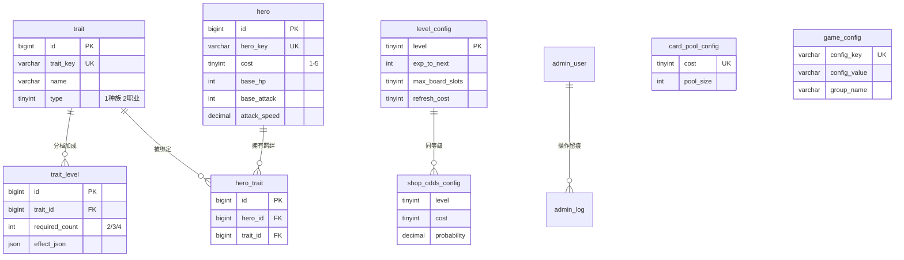
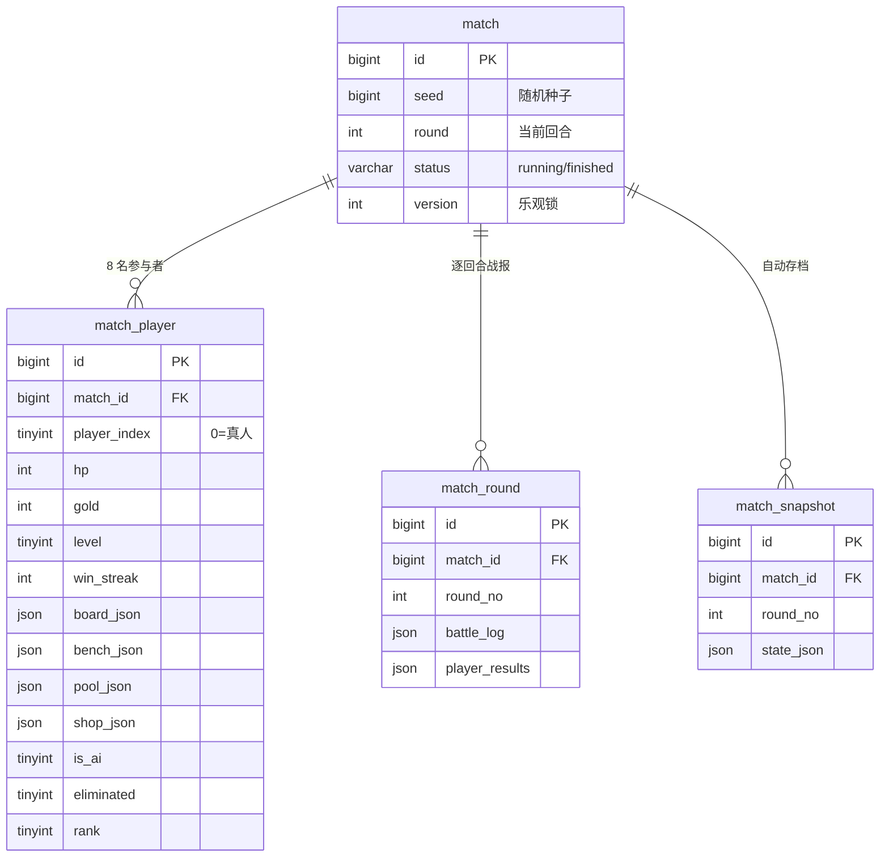

# 01 · 数据库设计说明书（弈灵诀）

> 数据库：`yi_ling_jue` · MySQL 8.0 · InnoDB · utf8mb4 / utf8mb4_unicode_ci
> 建库脚本：`database/schema.sql`（15 表）· 初始化：`database/seed.sql` · 一键重建：`database/reset.sql`
> 本文是**表结构、字段语义与数值口径的唯一真值**，`schema.sql` / `seed.sql` / `server/src/engine` 均以此为准。

---

## 1. 设计目标与约定

### 1.1 业务形态

- 单机自走棋：一局 = **1 名真人 + 7 名 AI**，共 8 名参与者，同局对战、共享一个卡池。
- 无联机、无房间、无观战、无装备、无选秀回合（详见 §8 裁剪说明）。
- 全部数值（收入、利息、星级、概率、羁绊加成、扣血、积分）由**配置表驱动**，代码里不写死数字。

### 1.2 命名与类型约定

| 约定 | 说明 |
| --- | --- |
| 表名 | 全小写 + 下划线，单数名词（`trait` / `match` / `match_player`） |
| 主键 | `id BIGINT AUTO_INCREMENT`；纯配置维度的从表用业务唯一键做联合主键（`level_config.level`） |
| 时间 | `create_time` / `update_time`，`DATETIME`，默认 `CURRENT_TIMESTAMP`，`update_time` 带 `ON UPDATE` |
| 布尔 | 统一 `TINYINT`（1/0），不用 `BOOLEAN` 别名，避免 ORM 与驱动程序歧义 |
| 枚举 | 用 `TINYINT` + 注释约定（`trait.type` 1 种族 / 2 职业），**不用 `ENUM`**，便于后台增删 |
| 金额 / 概率 | 概率 `DECIMAL(6,4)`，禁止 `FLOAT`，保证「每级 5 条之和 = 1.0000」可精确校验 |
| 大对象 | 只放**可整体替换**的状态（棋盘、商店、卡池、战报），不放需要 SQL 检索的业务字段 |

### 1.3 为什么只有 15 张表

旧版设计（`auto_chess`，20 表 + 视图）里有 `player`、`player_stat`、`match_hero`（棋子实例表）、`match_shop`、`match_card_pool`、`leaderboard` 视图等。弈灵诀版本把它们**折叠**为：

- 棋子实例 / 商店 / 卡池 / 棋盘 → `match_player` 的 4 个 JSON 列（`board_json` / `bench_json` / `pool_json` / `shop_json`）。
  理由：这些数据**永远按玩家整取整存**，不存在「按棋子行查询」的需求；采用 JSON 后，一次回合结算只需更新 8 行，事务边界清晰，也避免了「卡池拆行后必须 `SELECT ... FOR UPDATE` 锁 188 行」的并发负担。
- 玩家账号体系 → **裁剪**。单机形态下设备即身份，无注册、无跨设备同步；`admin_user` 只服务 Web 管理后台。
- 战绩 / 排行榜 → 由 `match` + `match_player`（`rank` 字段）直接聚合，不再建冗余统计表与视图。

---

## 2. E-R 图

### 2.1 静态配置域（只读为主，后台可改）



### 2.2 对局域（运行时写）



### 2.3 关系与基数

| 关系 | 基数 | 语义与级联 |
| --- | --- | --- |
| `trait` → `trait_level` | 1 : 2~3 | 一个羁绊 2 档（仅 3 英雄的羁绊）或 3 档；`ON DELETE CASCADE` |
| `hero` ↔ `trait` | M : N | 经 `hero_trait` 关联，每英雄通常 2 个羁绊（黄泉冥王仅 1 个）；`(hero_id, trait_id)` 唯一 |
| `card_pool_config` ↔ `hero` | 1 : N | 按 `cost` 关联（非外键），`pool_size` 必须能被该费用英雄数整除 |
| `level_config` ↔ `shop_odds_config` | 1 : 5 | 同一 `level` 下 5 个费用档，概率和为 1 |
| `match` → `match_player` | 1 : 8 | `player_index` 0~7 唯一，0 为真人；`ON DELETE CASCADE` |
| `match` → `match_round` | 1 : N | `(match_id, round_no)` 唯一，一回合一条战报 |
| `match` → `match_snapshot` | 1 : N | 每回合结算后追加一条，可回退到任意回合 |

---

## 3. 数据表清单

| # | 表名 | 类型 | 行数量级 | 作用 |
| --- | --- | --- | --- | --- |
| 1 | `admin_user` | 配置/账号 | 个位数 | 后台管理员 |
| 2 | `trait` | 静态配置 | 12 | 羁绊定义（6 种族 + 6 职业） |
| 3 | `trait_level` | 静态配置 | 33 | 羁绊档位与 `effect_json` |
| 4 | `hero` | 静态配置 | 24 | 英雄白板属性 |
| 5 | `hero_trait` | 关联表 | 47 | 英雄 ↔ 羁绊 |
| 6 | `card_pool_config` | 静态配置 | 5 | 各费用卡池总量（合计 188） |
| 7 | `level_config` | 静态配置 | 9 | 等级 / 经验 / 人口 / 刷新费 |
| 8 | `shop_odds_config` | 静态配置 | 45 | 9 级 × 5 费概率矩阵 |
| 9 | `game_config` | 全局参数 | 23 | 经济、战斗、积分等标量参数 |
| 10 | `match` | 运行时 | 每局 1 | 对局主表 |
| 11 | `match_player` | 运行时 | 每局 8 | 参与者状态（含棋盘/商店/卡池 JSON） |
| 12 | `match_round` | 运行时 | 每局 ≤30 | 回合战报与结算结果 |
| 13 | `match_snapshot` | 运行时 | 每局 ≤30 | 存档，支持「继续上局」 |
| 14 | `idempotency_record` | 基础设施 | 增长 | 写接口幂等去重 |
| 15 | `admin_log` | 审计 | 增长 | 后台修改配置的变更留痕 |

> 视图：**0 个**。排行榜与战绩由 `match_player` 聚合查询得到，不建冗余视图。

---

## 4. 数据字典

> 「必填」列中 ✔ 表示 `NOT NULL`；「默认」为空表示无默认值。

### 4.1 `admin_user` 后台管理员

| 字段 | 类型 | 必填 | 默认 | 说明 |
| --- | --- | --- | --- | --- |
| `id` | BIGINT | ✔ | AI | 主键 |
| `username` | VARCHAR(50) | ✔ | — | 登录账号，唯一 |
| `password` | VARCHAR(100) | ✔ | — | bcrypt 哈希（cost=10），禁止存明文 |
| `status` | TINYINT | ✔ | 1 | 1 启用 / 0 禁用（禁用后登录返回 2003） |
| `create_time` | DATETIME | ✔ | now | 创建时间 |
| `update_time` | DATETIME | ✔ | now | 更新时间 |

### 4.2 `trait` 羁绊定义

| 字段 | 类型 | 必填 | 默认 | 说明 |
| --- | --- | --- | --- | --- |
| `id` | BIGINT | ✔ | AI | 主键，**约定 1-6 种族 / 7-12 职业** |
| `trait_key` | VARCHAR(50) | ✔ | — | 唯一标识，如 `race_human`、`job_swordsman` |
| `name` | VARCHAR(50) | ✔ | — | 中文名（人族 / 剑修 …） |
| `type` | TINYINT | ✔ | — | 1 = 种族，2 = 职业 |
| `description` | VARCHAR(255) | — | NULL | 一句话说明，用于图鉴 |
| `create_time` | DATETIME | ✔ | now | 创建时间 |

### 4.3 `trait_level` 羁绊档位效果

| 字段 | 类型 | 必填 | 默认 | 说明 |
| --- | --- | --- | --- | --- |
| `id` | BIGINT | ✔ | AI | 主键 |
| `trait_id` | BIGINT | ✔ | — | FK → `trait.id`，级联删除 |
| `required_count` | INT | ✔ | — | 激活所需**不同英雄**数，主档位 2/3/4 |
| `effect_json` | JSON | ✔ | — | 效果对象，键表见 §5.3 |

唯一键 `(trait_id, required_count)`：同一羁绊不允许重复档位。

### 4.4 `hero` 英雄棋子

| 字段 | 类型 | 必填 | 默认 | 说明 |
| --- | --- | --- | --- | --- |
| `id` | BIGINT | ✔ | AI | 主键，1~24 |
| `hero_key` | VARCHAR(50) | ✔ | — | 唯一标识，如 `hero_yellow_king` |
| `name` | VARCHAR(50) | ✔ | — | 中文名 |
| `cost` | TINYINT | ✔ | — | 费用 1~5，`CHECK (cost BETWEEN 1 AND 5)` |
| `base_hp` | INT | ✔ | — | **一星**基础血量 |
| `base_attack` | INT | ✔ | — | **一星**基础攻击力 |
| `attack_speed` | DECIMAL(3,2) | ✔ | — | 每秒攻击次数（不随星级变化） |
| `skill_desc` | VARCHAR(500) | — | NULL | 技能文案；当前版本技能系统裁剪，全部为 NULL |
| `enabled` | TINYINT | ✔ | 1 | 1 上架可抽 / 0 下架（不影响已有对局） |
| `create_time` / `update_time` | DATETIME | ✔ | now | — |

### 4.5 `hero_trait` 英雄羁绊关联

| 字段 | 类型 | 必填 | 说明 |
| --- | --- | --- | --- |
| `id` | BIGINT | ✔ | 主键 |
| `hero_id` | BIGINT | ✔ | FK → `hero.id`，级联删除 |
| `trait_id` | BIGINT | ✔ | FK → `trait.id`，级联删除 |

`UNIQUE (hero_id, trait_id)`；`KEY (trait_id)` 支撑「反查某羁绊的所有英雄」，这是 `balance.loader` 校验档位可达性的依据。

### 4.6 `card_pool_config` 卡池容量

| 字段 | 类型 | 必填 | 说明 |
| --- | --- | --- | --- |
| `id` | BIGINT | ✔ | 主键 |
| `cost` | TINYINT | ✔ | 费用档，唯一 |
| `pool_size` | INT | ✔ | 该费用卡池总量 |

当前值：1 费 96（8 英雄 × 12）、2 费 48（6 × 8）、3 费 24（4 × 6）、4 费 16（4 × 4）、5 费 4（2 × 2），合计 **188**。

### 4.7 `level_config` 等级配置

| 字段 | 类型 | 必填 | 说明 |
| --- | --- | --- | --- |
| `level` | TINYINT | ✔ | 主键，1~9 |
| `exp_to_next` | INT | ✔ | 升到下一级所需经验（1/2/4/8/16/24/32/40；9 级填 0 表示封顶，无下一级） |
| `max_board_slots` | TINYINT | ✔ | 最大上场人口 |
| `refresh_cost` | TINYINT | ✔ | 刷新商店花费（1~5 级 2 金，6~7 级 3 金，8~9 级 4 金） |

### 4.8 `shop_odds_config` 商店概率

| 字段 | 类型 | 必填 | 说明 |
| --- | --- | --- | --- |
| `id` | BIGINT | ✔ | 主键 |
| `level` | TINYINT | ✔ | 玩家等级 1~9 |
| `cost` | TINYINT | ✔ | 费用档 1~5 |
| `probability` | DECIMAL(6,4) | ✔ | 出该费用卡的概率；**同一 level 的 5 行之和必须 = 1.0000** |

`UNIQUE (level, cost)`。例：9 级 = 1% / 5% / 20% / 50% / 24%。

### 4.9 `game_config` 全局参数

| 字段 | 类型 | 必填 | 说明 |
| --- | --- | --- | --- |
| `id` | BIGINT | ✔ | 主键 |
| `config_key` | VARCHAR(50) | ✔ | 参数键，唯一，驼峰化后即引擎字段名 |
| `config_value` | VARCHAR(100) | ✔ | 参数值（字符串存储，类型由加载器声明） |
| `group_name` | VARCHAR(50) | — | `economy` / `combat` / `battle` / `rank` / `system` |
| `remark` | VARCHAR(255) | — | 中文说明，后台直接展示 |

参数分组（23 项）：经济 9、战斗 11、积分 2、系统 1。JSON 型参数 `streak_bonus_rules` / `sell_refund_rule` / `rank_score_map` 存 JSON 字符串，由加载器 `JSON.parse`。

### 4.10 `match` 对局主表

| 字段 | 类型 | 必填 | 默认 | 说明 |
| --- | --- | --- | --- | --- |
| `id` | BIGINT | ✔ | AI | 对局 ID |
| `seed` | BIGINT | ✔ | — | 随机种子；同 seed + 同操作序列 = 同结果，可复现复盘 |
| `round` | INT | ✔ | 1 | 当前回合号 |
| `status` | VARCHAR(20) | ✔ | `running` | `running` / `finished` |
| `version` | INT | ✔ | 0 | 乐观锁版本号，每次写操作 +1 |
| `create_time` / `update_time` | DATETIME | ✔ | now | — |

### 4.11 `match_player` 对局内玩家（核心表）

| 字段 | 类型 | 必填 | 默认 | 说明 |
| --- | --- | --- | --- | --- |
| `id` | BIGINT | ✔ | AI | 主键 |
| `match_id` | BIGINT | ✔ | — | FK → `match.id`，级联删除 |
| `player_index` | TINYINT | ✔ | — | 0~7，**0 固定为真人**，1~7 为 AI；`UNIQUE (match_id, player_index)` |
| `hp` | INT | ✔ | 100 | 血量，`<= 0` 视为淘汰 |
| `gold` | INT | ✔ | 5 | 金币 |
| `level` | TINYINT | ✔ | 1 | 等级 1~9，决定人口上限与出卡概率 |
| `exp` | INT | ✔ | 0 | 当前等级已累积经验 |
| `win_streak` | INT | ✔ | 0 | **连胜为正、连败为负**，用单列表示两种连击 |
| `board_json` | JSON | ✔ | — | 上场棋子数组，元素含 `instanceId / heroId / star / row / col` |
| `bench_json` | JSON | ✔ | — | 备战席棋子数组（长度 ≤ `bench_size`） |
| `pool_json` | JSON | ✔ | — | 本局剩余卡池 `[{heroId, cost, remaining}]`，8 人共享同一份逻辑数据 |
| `shop_json` | JSON | ✔ | — | 当前商店 `[{slotNo, heroId, cost, locked}]` |
| `is_ai` | TINYINT | ✔ | 0 | 0 真人 / 1 AI |
| `eliminated` | TINYINT | ✔ | 0 | 0 存活 / 1 淘汰 |
| `eliminated_round` | INT | — | NULL | 淘汰回合号；名次排序时**晚淘汰者名次更高** |
| `rank` | TINYINT | — | NULL | 最终名次 1~8，淘汰或结算时写入 |

> `win_streak` 为负数即连败：结算时 `updateStreak` 对同号累加、异号重置为 ±1，奖励按绝对值查 `streak_bonus_rules`。

### 4.12 `match_round` 回合战斗记录

| 字段 | 类型 | 必填 | 说明 |
| --- | --- | --- | --- |
| `id` | BIGINT | ✔ | 主键 |
| `match_id` | BIGINT | ✔ | FK → `match.id`，级联删除 |
| `round_no` | INT | ✔ | 回合号，`UNIQUE (match_id, round_no)` |
| `battle_log` | JSON | — | 战斗时间轴 `{seed, durationSeconds, timeline:[...]}`，前端按此播放简版动画 |
| `player_results` | JSON | — | 8 名参与者本回合结果：对手、胜负、收入明细、扣血、存活数 |
| `create_time` | DATETIME | ✔ | 写入时间 |

### 4.13 `match_snapshot` 对局存档

| 字段 | 类型 | 必填 | 说明 |
| --- | --- | --- | --- |
| `id` | BIGINT | ✔ | 主键 |
| `match_id` | BIGINT | ✔ | FK → `match.id`，级联删除 |
| `round_no` | INT | ✔ | 存档回合 |
| `state_json` | JSON | ✔ | 完整对局状态（8 名参与者 + 卡池 + 商店 + `rngState`），可直接还原继续 |
| `create_time` | DATETIME | ✔ | 存档时间 |

`state_json.rngState` 保存 `rng.exportState()` 的结果：读档后随机序列从断点继续，**不会因读档而改变后续抽卡结果**。

### 4.14 `idempotency_record` 幂等记录

| 字段 | 类型 | 必填 | 说明 |
| --- | --- | --- | --- |
| `id` | BIGINT | ✔ | 主键 |
| `client_request_id` | VARCHAR(64) | ✔ | 客户端请求 UUID，唯一 |
| `scene` | VARCHAR(50) | — | 业务场景：`shop.refresh` / `shop.buy` / `round.battle` … |
| `result_json` | JSON | — | 首次执行的响应体，重复请求原样返回 |
| `expire_time` | DATETIME | — | 过期时间（`idempotency_ttl_seconds`，默认 300 秒） |
| `create_time` | DATETIME | ✔ | 写入时间 |

### 4.15 `admin_log` 后台操作日志

| 字段 | 类型 | 必填 | 说明 |
| --- | --- | --- | --- |
| `id` | BIGINT | ✔ | 主键 |
| `admin_id` | BIGINT | ✔ | FK → `admin_user.id` |
| `action` | VARCHAR(50) | ✔ | `update_hero` / `update_trait_level` / `update_shop_odds` … |
| `target` | VARCHAR(100) | — | 目标对象，如 `hero:23` |
| `detail` | JSON | — | 变更前后值 `{before, after}` |
| `create_time` | DATETIME | ✔ | 操作时间 |

---

## 5. 数值一致性约束（重点）

数据库只保证**结构**正确，下面这些**业务不变量**由「seed 脚本 + `balance.loader` 校验 + 单元测试」三层保证。

### 5.1 概率闭合

```sql
-- 每个等级 5 个费用档之和必须恰好为 1.0000；返回 0 行才算通过
SELECT level, SUM(probability) AS total
FROM shop_odds_config
GROUP BY level
HAVING total <> 1.0000;
```

`DECIMAL(6,4)` 保证求和是精确十进制，不会出现 `0.9999999`。加载器另有 `1e-6` 容差校验，非法配置直接抛错，不进缓存。

### 5.2 卡池可均分

```sql
SELECT c.cost, c.pool_size,
       (SELECT COUNT(*) FROM hero WHERE cost = c.cost AND enabled = 1) AS hero_num
FROM card_pool_config c
WHERE c.pool_size % (SELECT COUNT(*) FROM hero WHERE cost = c.cost AND enabled = 1) <> 0;
```

返回 0 行 = 每个费用档都能被该档英雄**均分**（1 费每英雄 12 张，5 费每英雄 2 张）。
否则抽卡时各英雄余量会先天不均，破坏概率公平性。

### 5.3 `effect_json` 词表（16 键）

**百分比一律使用整数百分数**（`12` 表示 12%），由 `engine/stats.js` 统一除以 100；`hpThreshold` 与 `reviveChance` 本身就是小数，不做换算。

| 键 | 含义 | 作用范围 | 单位 | 消费方 |
| --- | --- | --- | --- | --- |
| `atkPercent` | 攻击力提升 | 携带者 | 整数% | `stats` 乘法通道 |
| `hpPercent` | 生命上限提升 | 携带者 | 整数% | `stats` 乘法通道 |
| `hpThreshold` | 残血判定阈值 | 携带者 | 小数 | `combat` 条件触发 |
| `lowHpDmgPercent` | 对残血目标额外伤害 | 携带者 | 整数% | `combat` 条件触发 |
| `spellLifesteal` | 法术吸血 | 携带者 | 整数% | `combat` 伤害回血 |
| `skillDmgPercent` | 技能伤害提升 | 携带者 | 整数% | `combat` |
| `critRate` | 暴击率 | 携带者 | 整数% | `stats` 概率通道（夹 [0,1]） |
| `critDmgPercent` | 暴击伤害提升 | 携带者 | 整数% | `combat` |
| `cdReduce` | 技能冷却缩减 | 携带者 | 整数% | `combat` |
| `healPercent` | 治疗量提升 | 携带者 | 整数% | `combat` |
| `reviveChance` | 复生概率 | 携带者 | 小数 | `combat` |
| `reviveHpPercent` | 复生后血量比例 | 携带者 | 整数% | `combat` |
| `summonAtkPercent` | 召唤物攻击 | 携带者 | 整数% | 预留（召唤系统裁剪） |
| `summonHpPercent` | 召唤物生命 | 携带者 | 整数% | 预留 |
| `allyAsPercent` | 友方攻速提升 | 全队 | 整数% | `stats.resolveTeamStats` |
| `enemyAsSlowPercent` | 敌方攻速降低 | 敌方 | 整数% | `stats.resolveTeamStats` |

> 加载器对未知键**不报错但会告警**，`stats.parseEffect` 对未知键**直接抛错**——两个层次的防线，保证配置写错不会静默失效为 0 加成。

### 5.4 档位可达成

「同名英雄只计 1」，因此某档 `required_count` 若大于该羁绊绑定的英雄总数，该档永远无法激活。当前配置：

- 主档位 **2 / 3 / 4**；
- 灵族（3 英雄）、符师（3 英雄）、御兽师（3 英雄）只配到 **2 / 3** 两档。

```sql
-- 返回 0 行才算没有「永远激活不了」的档位
SELECT t.name, tl.required_count, COUNT(ht.id) AS heroes
FROM trait_level tl
JOIN trait t ON t.id = tl.trait_id
LEFT JOIN hero_trait ht ON ht.trait_id = tl.trait_id
GROUP BY tl.id, t.name, tl.required_count
HAVING tl.required_count > COUNT(ht.id);
```

### 5.5 其他不变量

| 不变量 | 校验方式 |
| --- | --- |
| 每个英雄 1~2 个羁绊，总数 47 | `SELECT hero_id, COUNT(*) FROM hero_trait GROUP BY hero_id HAVING COUNT(*) NOT BETWEEN 1 AND 2` |
| 12 个羁绊、每个至少 2 档 | `SELECT trait_id, COUNT(*) FROM trait_level GROUP BY trait_id HAVING COUNT(*) < 2` |
| `trait.type` 只有 1/2，且种族 6 个、职业 6 个 | `SELECT type, COUNT(*) FROM trait GROUP BY type` |
| 9 级 × 5 费 = 45 行 | `SELECT COUNT(*) FROM shop_odds_config` |

---

## 6. 索引、事务与范式权衡

### 6.1 索引策略

| 索引 | 所在表 | 用途 |
| --- | --- | --- |
| `uk_match_player (match_id, player_index)` | `match_player` | 读一局 8 人；同时是唯一性保证 |
| `uk_match_round (match_id, round_no)` | `match_round` | 按回合取战报，防重复写 |
| `idx_snapshot_match (match_id, round_no)` | `match_snapshot` | 取最新存档 `ORDER BY round_no DESC LIMIT 1` |
| `idx_match_status (status)` | `match` | 后台按状态审计对局 |
| `idx_ht_trait (trait_id)` | `hero_trait` | 反查羁绊英雄列表（档位可达性校验） |
| `idx_hero_cost (cost)` | `hero` | 图鉴按费用筛选、卡池均分校验 |
| `uk_client_request (client_request_id)` | `idempotency_record` | 幂等查重，唯一键即索引 |

### 6.2 事务边界

| 操作 | 事务内容 | 锁 |
| --- | --- | --- |
| 刷新商店 | 扣金 → 抽 5 张 → 扣 `pool_json` → 写 `shop_json` → `version+1` | `SELECT ... FOR UPDATE` 锁本人 `match_player` 行 |
| 购买 / 出售 | 校验 → 金额与 `bench_json` / `pool_json` 同改 → 三合一升星判定 | 同上 |
| 回合结算 | 写 `match_round` → 8 人 `hp/gold/win_streak` → 淘汰与名次 → 写 `match_snapshot` → `match.round+1` | 锁 `match` 行 + 8 行 `match_player` |

战斗模拟本身是纯计算，**不在事务内查库**：一次性读出双方阵容与配置，算完再单事务写回。这样长事务不会包含 CPU 密集模拟。

### 6.3 范式权衡（答辩必问）

**故意违反 1NF 的地方**：`board_json` / `bench_json` / `shop_json` / `pool_json` 四个 JSON 列。

- 好处：一回合结算只更新 8 行；卡池不必锁 188 行；存档只需序列化一份 JSON；棋子实例不需要独立主键（旧设计 `match_hero.instance_id` 的自增冲突问题直接消失）。
- 代价：无法用 SQL 直接统计「某英雄登场率」。若后台需要，可在 `match_round.player_results` 里冗余英雄快照，或离线解析 JSON。
- 边界：**凡是需要 WHERE / JOIN / 聚合的字段，一律拆成列**（`hp`、`gold`、`level`、`rank`、`eliminated` 都是真实列），JSON 只放「整体读写」的结构。

---

## 7. 执行方式

```bash
# 建库建表（会先 DROP DATABASE，可重复执行）
mysql -u root -p < database/schema.sql
# 导入配置数据
mysql -u root -p < database/seed.sql
# 一键重建
mysql -u root -p < database/reset.sql
```

执行后的自检（应全部返回预期值）：

```sql
USE yi_ling_jue;
SELECT COUNT(*) FROM information_schema.tables WHERE table_schema = 'yi_ling_jue'; -- 15
SELECT COUNT(*) FROM hero;                -- 24
SELECT COUNT(*) FROM trait;               -- 12
SELECT COUNT(*) FROM trait_level;         -- 33
SELECT COUNT(*) FROM hero_trait;          -- 47
SELECT COUNT(*) FROM shop_odds_config;    -- 45
SELECT COUNT(*) FROM game_config;         -- 23
SELECT SUM(pool_size) FROM card_pool_config; -- 188
```

后端侧再跑一次配置层自检：

```bash
cd server && npm run config:check   # 读取真实库 → 校验 → engine 冒烟
```

---

## 8. 裁剪说明（与旧版差异）

| 旧设计（`auto_chess` 20 表） | 弈灵诀（15 表） | 原因 |
| --- | --- | --- |
| `player` / `player_stat` | 删除 | 单机形态无账号体系，设备即身份 |
| `match_hero` 棋子实例表 | 并入 `match_player.board_json` / `bench_json` | 永远整取整存，无需按棋子行查询 |
| `match_shop` | 并入 `match_player.shop_json` | 每次刷新整体替换 |
| `match_card_pool`（188 行/局） | 并入 `match_player.pool_json` | 避免锁 188 行 |
| `v_leaderboard` 视图 | 删除 | 无账号，排行榜无意义 |
| 独立 `battle_log` 表 | 并入 `match_round.battle_log` | 一回合一条，1:1 关系 |
| 装备 / 选秀 / 观战相关表 | 未设计 | 功能裁剪，不做 |

这些裁剪都写进了答辩口径：**表少不代表功能少，而是把「按行访问」的数据留在表里，把「整体读写」的状态收进 JSON**，用事务边界与加载器校验换取实现复杂度下降。
