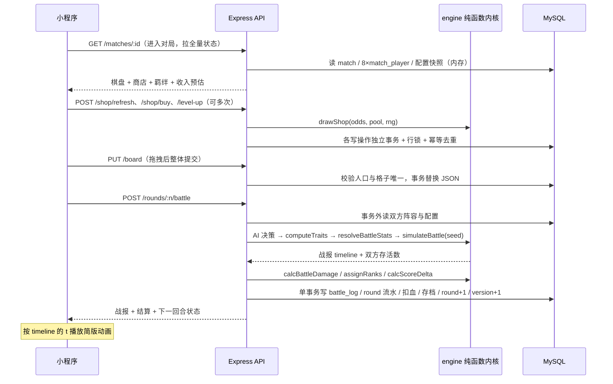

# 02 · 后端接口设计清单（弈灵诀）

> 技术栈：Express 4 / Node.js 18+ / MySQL 8.0
> 统一前缀：`/api/v1`
> 数据模型：`docs/01-数据库设计.md`（15 表），本文所有接口的字段都出自这 15 张表
> 适用范围：**UniApp 小程序与 Vue3 Web 管理后台共用同一套接口**，不设双份 API

---

## 1. 统一约定

### 1.1 一套接口如何供两端复用

| 维度 | 小程序（UniApp） | Web 管理后台（Vue3） |
| --- | --- | --- |
| 登录 | `POST /auth/miniapp/login`（微信 code 换 openid） | `POST /auth/admin/login`（账号密码 + bcrypt） |
| JWT role | `player` | `admin` |
| 读图鉴 / 配置 | `GET /heroes`、`GET /config/*` | 同左，**不另开接口** |
| 改图鉴 / 配置 | 无权限（2002） | `PUT /admin/...` |
| 对局数据 | 走 `/matches/*` | 复用同一组读接口 + `/admin/matches` 审计 |

两份 `request` 封装只有 baseURL 与 token 存储位置不同，拦截器（错误码、loading、重试、幂等 ID）逻辑一致，便于课设说明「接口复用」。

> **单机形态的权限说明**：本项目无 `player` 表（见 docs/01 §1.3），小程序登录只用于签发 `role=player` 的 JWT 并绑定 openid，**不做账号持久化**。对局数据的访问控制依赖不可枚举的 `matchId` + 本地存储；这是单机课设的显式取舍，若需严格归属校验，只需给 `match` 表加一列 `owner_openid`，改动量一行 SQL + 一处中间件。

### 1.2 请求 / 响应规范

- 请求头：`Authorization: Bearer <JWT>`、`Content-Type: application/json`
- **所有写操作**（POST / PUT / DELETE）必须带 `clientRequestId`（UUID v4），服务端在 `idempotency_ttl_seconds`（默认 300 秒）内去重，防止小程序连点造成重复扣金。
- 成功响应：

```json
{
  "code": 0,
  "message": "ok",
  "data": { },
  "requestId": "req_8f3c1d",
  "timestamp": 1763500000000
}
```

- 失败响应：

```json
{
  "code": 3001,
  "message": "金币不足：刷新需要 2，当前 1",
  "data": null,
  "requestId": "req_8f3c1d",
  "timestamp": 1763500000000
}
```

- 分页统一：`?page=1&pageSize=20` → `{ list, total, page, pageSize }`；排序 `?sort=-createTime`。
- 所有**金币变动**的接口都在响应里带上 `goldBefore / goldAfter`，方便前端与人工对账。

### 1.3 错误码表

| code | HTTP | 含义 | 常见触发点 |
| --- | --- | --- | --- |
| 0 | 200/201 | 成功 | — |
| 1001 | 400 | 参数校验失败 | 缺字段、布局坐标越界 |
| 1002 | 409 | 重复请求 / 缺少 `clientRequestId` | 幂等拦截 |
| 2001 | 401 | 未登录或 token 失效 | — |
| 2002 | 403 | 角色权限不足 | player 访问 `/admin/*` |
| 2003 | 403 | 账号被禁用 | `admin_user.status = 0` |
| 3001 | 422 | 金币不足 | 刷新 / 购买 / 买经验 |
| 3002 | 422 | 卡池该费用已抽空 | 刷新商店（余量全 0） |
| 3003 | 422 | 备战席已满 | 购买棋子 |
| 3004 | 409 | 人口已达上限 / 目标格已被占用 | 提交棋盘 |
| 3005 | 409 | 当前阶段不允许该操作 | 已结算后继续买棋子 |
| 3006 | 404 | 棋子不存在或不属于本人 | 出售 / 移动 |
| 3007 | 409 | 对局已结束 | `status = finished` 后继续操作 |
| 3008 | 409 | 版本号冲突（请重新拉取） | 乐观锁 `version` 不匹配 |
| 3009 | 422 | 等级已满 / 经验不足 | 买经验、升级 |
| 3010 | 422 | 该星级棋子不足 3 个，无法升星 | 手动合成 |
| 4001 | 422 | 配置校验失败 | 概率和 ≠ 1、档位重复、卡池不可均分 |
| 5000 | 500 | 服务器内部错误 | 事务回滚 |

### 1.4 事务与并发

| 操作 | 事务内的读 | 事务内的写 | 并发控制 |
| --- | --- | --- | --- |
| 刷新商店 | `match_player FOR UPDATE` | `gold` / `shop_json` / `pool_json` | `match.version` 乐观锁 |
| 购买 / 出售 | 同上 + 配置快照（内存） | `gold` / `bench_json` / `board_json` / `pool_json` | 同上 |
| 提交棋盘 | `match_player FOR UPDATE` | `board_json` / `bench_json` | 同上 |
| 回合战斗 | `match` + 8×`match_player FOR UPDATE` | `match_round` / 8×玩家 / `match_snapshot` / `match.round` | `match.version` |

**战斗模拟是纯计算不查库**：进事务前一次性读出阵容与配置，事务内只做写回，避免 CPU 密集运算占着行锁。

---

## 2. 接口清单

优先级：**P0 = 课设必做**（能跑通一局），P1 = 建议做（后台管理、存档），P2 = 扩展。

### A. 认证（3 个）

| 方法 | 路径 | 权限 | 优先级 | 说明 |
| --- | --- | --- | --- | --- |
| POST | `/auth/miniapp/login` | 公开 | P0 | `{ code }` → 微信 `code2session` 得 openid → 签发 `role=player` JWT（不入库） |
| POST | `/auth/admin/login` | 公开 | P0 | `{ username, password }` → 查 `admin_user` → bcrypt 校验 → 签发 `role=admin` JWT |
| GET | `/auth/me` | 已登录 | P1 | 返回 `{ role, openid/username, expiresAt }` |

### B. 静态配置与图鉴 · 只读（8 个）

| 方法 | 路径 | 权限 | 优先级 | 说明 |
| --- | --- | --- | --- | --- |
| GET | `/config/balance` | 已登录 | P0 | 全部 `game_config`，按 `group_name` 分组；小程序启动拉取并缓存 |
| GET | `/config/levels` | 已登录 | P0 | 9 级 `exp_to_next / max_board_slots / refresh_cost` |
| GET | `/config/shop-odds` | 已登录 | P0 | 9×5 概率矩阵 + 每级合计（用于校验展示） |
| GET | `/config/card-pool` | 已登录 | P1 | 5 个费用档的 `pool_size` 与每英雄张数 |
| GET | `/heroes` | 已登录 | P0 | 英雄列表，`?cost=&page=&pageSize=`，含羁绊 id 数组 |
| GET | `/heroes/:id` | 已登录 | P0 | 英雄详情：白板属性 + 羁绊（含各档效果） |
| GET | `/traits` | 已登录 | P0 | 羁绊列表，`?type=1/2`，含档位数组 |
| GET | `/traits/:id` | 已登录 | P1 | 羁绊详情 + 绑定该羁绊的英雄列表 + 档位效果 |

### C. 对局生命周期（8 个）

| 方法 | 路径 | 权限 | 优先级 | 说明 |
| --- | --- | --- | --- | --- |
| POST | `/matches` | player | P0 | 创建对局：写 1 真人 + 7 AI（`player_index` 0~7）、初始化 `pool_json`、发初始金币、首次刷新商店、写第 0 回合存档 |
| GET | `/matches` | player | P0 | 对局列表 `?status=&page=`（「继续上局」取 `running` 第一条） |
| GET | `/matches/:id` | player | P0 | **聚合状态**：对局 + 8 人血量/名次 + 我的棋盘与备战席 + 商店 + 羁绊 + 收入预估 |
| GET | `/matches/:id/board` | player | P0 | 棋盘 + 备战席（拖拽页单独拉，减少负载） |
| POST | `/matches/:id/surrender` | player | P1 | 投降：按当前存活人数定名次并结算积分 |
| GET | `/matches/:id/result` | player | P0 | 最终名次、积分变化、回合汇总 |
| POST | `/matches/:id/next-round` | player | P2 | 异常恢复：强制推进回合（正常由 battle 内部推进） |
| DELETE | `/matches/:id` | player | P2 | 删除本地对局记录（级联清理子表） |

### D. 商店与经济（7 个）

| 方法 | 路径 | 权限 | 优先级 | 说明 |
| --- | --- | --- | --- | --- |
| GET | `/matches/:id/shop` | player | P0 | 当前 5 格商店 + 各格卡池余量 |
| POST | `/matches/:id/shop/refresh` | player | P0 | 扣 `refresh_cost` → 按等级概率 + `pool_json` 余量抽 5 张 → 替换 `shop_json`（保留锁定格） |
| POST | `/matches/:id/shop/buy` | player | P0 | `{ slotNo }`：校验金币与备战席 → 扣金 → 棋子入 `bench_json` → 扣 `pool_json` → **自动三合一升星** |
| POST | `/matches/:id/shop/lock` | player | P2 | `{ slotNo, locked }`，锁定格在刷新时保留 |
| POST | `/matches/:id/heroes/:instanceId/sell` | player | P0 | 退款 = `cost × sell_refund_rule[star]`，归还 `pool_json` |
| POST | `/matches/:id/level-up` | player | P0 | `{ count }`，每次 4 金换 4 经验，支持连升；升级后人口与概率立即生效 |
| GET | `/matches/:id/economy` | player | P0 | 当前金币 + 下回合收入预估（基础 / 利息 / 连胜连败）+ 配置快照 |

### E. 棋盘部署与羁绊（3 个）

| 方法 | 路径 | 权限 | 优先级 | 说明 |
| --- | --- | --- | --- | --- |
| PUT | `/matches/:id/board` | player | P0 | **推荐**：一次提交整个布局 `[{instanceId, location, row, col, benchIndex}]`，服务端整体校验后原子替换 |
| POST | `/matches/:id/board/deploy` | player | P1 | 单个棋子上阵 / 下阵 / 换位（逐格操作，便于调试） |
| GET | `/matches/:id/traits` | player | P0 | 实时羁绊：每个羁绊的不同英雄数、已激活档位、加成明细、距下一档还差几个 |

### F. 回合与战斗（5 个）

| 方法 | 路径 | 权限 | 优先级 | 说明 |
| --- | --- | --- | --- | --- |
| GET | `/matches/:id/rounds` | player | P0 | 回合列表（胜负、收入、扣血） |
| GET | `/matches/:id/rounds/:roundNo` | player | P0 | 回合详情 + 完整经济流水（对账用） |
| POST | `/matches/:id/rounds/:roundNo/battle` | player | P0 | **主链路**：AI 决策 → 配对 → 羁绊 → 模拟战斗 → 写战报 → 发金币 → 扣血 → 淘汰判定 → 存档 → 推进回合 |
| GET | `/matches/:id/rounds/:roundNo/battle` | player | P0 | 查询战报，含 `timeline` 关键帧（前端据此播放简版动画） |
| POST | `/matches/:id/rounds/:roundNo/settle` | player | P2 | 单独重放结算（调试 / 断点恢复），正式流程由 battle 内部调用 |

> **为什么战斗是一个同步 POST**：单机对战 AI 不需要 WebSocket 与实时推帧；一次请求返回完整战报，前端按 `battle_log.timeline` 的 `t` 播放即可。数值结算落在唯一事务里，最不容易出错。

### G. 存档（4 个）

| 方法 | 路径 | 权限 | 优先级 | 说明 |
| --- | --- | --- | --- | --- |
| GET | `/matches/:id/snapshots` | player | P1 | 存档列表（回合号 / 时间 / 血量摘要） |
| GET | `/matches/:id/snapshots/latest` | player | P0 | 取最新存档，用于「继续上局」 |
| POST | `/matches/:id/snapshots` | player | P1 | 手动存档（正常每回合结算自动写一条） |
| POST | `/matches/:id/snapshots/:sid/restore` | player | P0 | 校验 `version` → 事务内还原 `state_json` → `version+1` |

### H. 后台管理 · 仅 role=admin（22 个）

| 方法 | 路径 | 优先级 | 说明 |
| --- | --- | --- | --- |
| GET | `/admin/dashboard` | P1 | 对局数 / 平均回合数 / 每费用登场次数 / 各羁绊激活率 |
| GET | `/admin/config/balance` | P1 | 读全部 `game_config`（按 group） |
| PUT | `/admin/config/balance` | P1 | 批量更新标量参数，写 `admin_log` |
| GET | `/admin/config/levels` | P1 | 等级配置 |
| PUT | `/admin/config/levels` | P1 | 批量更新（校验 `max_board_slots` 单调不减） |
| GET | `/admin/config/shop-odds` | P1 | 9×5 概率矩阵 |
| PUT | `/admin/config/shop-odds` | P1 | **保存前校验每级合计 = 1.0000**，否则整批回滚（4001） |
| GET | `/admin/config/card-pool` | P2 | 卡池容量 |
| PUT | `/admin/config/card-pool` | P2 | 校验能被该费用英雄数整除 |
| GET | `/admin/heroes` | P1 | 英雄分页列表 |
| POST | `/admin/heroes` | P1 | 新增英雄（`cost` 1~5，`hero_key` 唯一） |
| PUT | `/admin/heroes/:id` | P1 | 改属性 / 上下架（`enabled`） |
| DELETE | `/admin/heroes/:id` | P2 | 删除；有对局引用时改为下架 |
| POST | `/admin/heroes/:id/traits` | P1 | 绑定羁绊（受「1~2 个」约束） |
| DELETE | `/admin/heroes/:id/traits/:traitId` | P2 | 解绑羁绊 |
| GET | `/admin/traits` | P1 | 羁绊列表 |
| PUT | `/admin/traits/:id` | P1 | 改名称 / 描述（`type` 不允许跨类改） |
| GET | `/admin/trait-levels` | P1 | 档位列表（含 `effect_json`） |
| PUT | `/admin/trait-levels/:id` | P1 | 改档位效果，按 §5.3 词表校验键名与单位 |
| GET | `/admin/matches` | P1 | 对局审计列表 |
| GET | `/admin/matches/:id` | P1 | 对局复盘（8 名参与者 + 全部回合战报） |
| GET | `/admin/operation-logs` | P2 | `admin_log` 分页查询 |

> 合计 **60 个接口**，其中 P0 共 **26 个**即可跑通完整一局（认证 2 + 配置图鉴 5 + 对局 5 + 商店经济 6 + 棋盘羁绊 2 + 回合战斗 4 + 存档 2）。
> **实现状态**：上述 26 个 P0 接口及部分低成本 P1 只读接口已落地在 `src/routes/index.js`，并在 `tests/integration/match.flow.test.js` 用真实 MySQL 跑通「登录 → 创建 → 刷新 → 购买 → 部署 → 战斗 → 战报 → 结算 → 存档 → 读档」全链路。H 组后台管理接口（22 个）尚未实现，属于下一阶段。

---

## 3. 关键接口示例

### 3.1 创建对局 `POST /api/v1/matches`

```json
// Request
{ "aiDifficulty": 2, "clientRequestId": "0e3d8c1a-4f2b-4b8e-9a11-7c2d5e6f8a90" }

// Response data
{
  "matchId": 10001,
  "seed": 881337212,
  "status": "running",
  "round": 1,
  "version": 1,
  "me": {
    "playerIndex": 0,
    "hp": 100, "gold": 5, "level": 1, "exp": 0,
    "maxBoardSlots": 1, "boardSlots": 0, "benchSize": 9
  },
  "players": [
    { "playerIndex": 1, "hp": 100, "isAi": 1, "eliminated": 0, "rank": null, "level": 1 }
  ],
  "shop": [
    { "slotNo": 1, "heroId": 1,  "name": "青衫剑卒",  "cost": 1, "remainingInPool": 11 },
    { "slotNo": 2, "heroId": 5,  "name": "木灵芽",    "cost": 1, "remainingInPool": 11 },
    { "slotNo": 3, "heroId": 4,  "name": "采药女",    "cost": 1, "remainingInPool": 11 },
    { "slotNo": 4, "heroId": 2,  "name": "山狐小妖",  "cost": 1, "remainingInPool": 11 },
    { "slotNo": 5, "heroId": 7,  "name": "魔兵杂役",  "cost": 1, "remainingInPool": 11 }
  ],
  "traits": [],
  "nextRoundIncome": { "base": 5, "interest": 0, "streak": 0, "total": 5 }
}
```

> 1 级只有 1 费卡（概率 100%），所以首刷必然是 1 费英雄；每个 1 费英雄池内 12 张，抽走 1 张后 `remainingInPool = 11`。

### 3.2 刷新商店 `POST /api/v1/matches/:id/shop/refresh`

服务端顺序（单事务）：锁 `match_player` 行 → 校验金币 ≥ `refresh_cost` → 扣款 → 读 `shop_odds_config[level]` → 按 `pool_json.remaining` 加权抽 5 张 → 保留 `locked` 格 → 替换 `shop_json` → `version+1`。

```json
// Response data
{
  "goldBefore": 5, "goldAfter": 3, "refreshCost": 2,
  "level": 1,
  "oddsSnapshot": { "1": 1.0, "2": 0, "3": 0, "4": 0, "5": 0 },
  "shop": [
    { "slotNo": 1, "heroId": 5, "name": "木灵芽", "cost": 1, "remainingInPool": 10 }
  ],
  "version": 2
}
```

### 3.3 提交棋盘 `PUT /api/v1/matches/:id/board`

```json
// Request：整体提交，服务端一次性校验（人口上限 / 格子唯一 / 坐标范围 / 棋子归属）
{
  "clientRequestId": "b7f1...",
  "version": 4,
  "layout": [
    { "instanceId": 50001, "location": 1, "row": 3, "col": 3 },
    { "instanceId": 50002, "location": 2, "benchIndex": 0 }
  ]
}
```

校验规则：`row ∈ [0, board_rows)`、`col ∈ [0, board_cols)`、同格只能 1 个棋子、场上棋子数 ≤ `max_board_slots[level]`、`instanceId` 必须存在于本人 `board_json ∪ bench_json`。

### 3.4 触发战斗 `POST /api/v1/matches/:id/rounds/:roundNo/battle`

```json
// Response data（节选）
{
  "roundNo": 1,
  "battle": {
    "opponent": { "playerIndex": 3, "hpBefore": 100 },
    "result": "win",
    "seed": 778812301,
    "humanSurvivors": 1,
    "opponentSurvivors": 0,
    "durationSeconds": 12.4,
    "timeline": [
      { "t": 0.9,  "actor": 50001, "target": 51001, "type": "attack", "value": 42, "targetHp": 558 },
      { "t": 6.2,  "actor": 50001, "target": 51001, "type": "crit",   "value": 84, "targetHp": 210 },
      { "t": 12.4, "actor": 50001, "target": 51001, "type": "kill",   "value": 0,  "targetHp": 0 }
    ]
  },
  "settlement": {
    "goldBefore": 3, "incomeBase": 5, "incomeInterest": 0,
    "incomeStreak": 0, "incomeTotal": 5, "goldAfter": 8,
    "damageToOpponent": 4, "damageToHuman": 0,
    "winStreak": 1, "hpAfter": 100
  },
  "activeTraits": [
    { "traitId": 1, "name": "人族", "heroCount": 2, "activeLevel": 2, "nextLevel": 3, "need": 1 }
  ],
  "snapshotId": 90012,
  "nextRound": 2,
  "version": 9
}
```

> 平局（双方同时清场或超时且存活数相同）时双方各扣 `base_round_damage`，`win_streak` 重置为 0。

---

## 4. 一回合调用时序



---

## 5. 接口与代码目录对应

| 分组 | 路由文件 | 控制器 | 服务 | 依赖引擎 |
| --- | --- | --- | --- | --- |
| A | `auth.routes.js` | `auth.controller.js` | `auth.service.js` | — |
| B | `catalog.routes.js` | `catalog.controller.js` | `catalog.service.js` | `balance.loader` |
| C | `match.routes.js` | `match.controller.js` | `match.service.js` / `round.service.js` | `rng` |
| D | `shop.routes.js` | `shop.controller.js` | `shop.service.js` / `hero.service.js` / `economy.service.js` | `probability` / `economy` |
| E | `board.routes.js` | `board.controller.js` | `board.service.js` / `trait.service.js` | `synergy` |
| F | `battle.routes.js` | `battle.controller.js` | `battle.service.js` / `ai.service.js` | `combat` / `damage` |
| G | `snapshot.routes.js` | `snapshot.controller.js` | `snapshot.service.js` | `rng`（状态导出） |
| H | `admin.routes.js` | `admin.controller.js` | `admin.service.js` | `balance.loader`（校验） |

> 分层规则：`routes → controllers → services → dao → MySQL`，`engine/` 只被 `services` 调用，**engine 内不出现任何 `require('mysql2'/'express')`**。这条规则由 `tests/unit` 里的静态检查用例守住。
