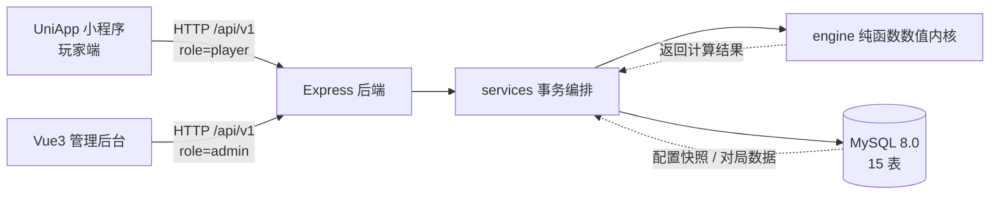

# 03 · 项目整体目录结构（弈灵诀）

> 架构：UniApp 微信小程序（Vue3 语法） + Vue3 Web 管理后台 + Express 后端 + MySQL 8.0
> 三端共用 `server` 一套 `/api/v1` 接口；单机对战 AI，无 WebSocket、无房间服务。
> 标记说明：**✅ 已实现**（本轮已跑通测试） · **🚧 进行中** · **⬜ 待实现**

---

## 1. 顶层结构

```
自走棋策略游戏/                        # 仓库根目录
├── docs/                              # 课程设计文档
│   ├── 01-数据库设计.md                # E-R 图、数据字典、约束说明（15 表）  ✅
│   ├── 02-后端接口清单.md              # 接口清单、错误码、时序图（60 个）    ✅
│   ├── 03-项目目录结构.md              # 本文件                              ✅
│   └── 04-测试与部署.md                # 单元测试用例、部署步骤、答辩截图      ⬜
│
├── database/                          # 数据库脚本（唯一真值）
│   ├── schema.sql                     # 建库 / 15 张表                      ✅
│   ├── seed.sql                       # 24 英雄 + 12 羁绊 + 33 档位 + 配置   ✅
│   ├── reset.sql                      # 一键重建                            ✅
│   └── 弈灵诀-数据库设计说明书.md       # 详细规格（DDL / seed / 校验 / 词表）
│
├── server/                            # Express 后端（三端共用）
├── miniapp/                           # UniApp 小程序（玩家端）              ⬜
├── admin-web/                         # Vue3 + Vite 管理后台                 ⬜
│
├── .gitignore
└── README.md                          # 项目简介 + 一键启动命令               ⬜
```

---

## 2. 后端 `server/`（重点）

```
server/
├── src/
│   ├── app.js                          # Express 实例：中间件装配、路由挂载          ✅
│   ├── server.js                       # 监听端口、优雅关闭、连接池释放             ✅
│   │
│   ├── config/
│   │   ├── db.js                       # mysql2 连接池（惰性 require，单测不碰驱动） ✅
│   │   └── balance.loader.js           # 8 张配置表 → 驼峰快照 + 校验 + TTL 缓存     ✅
│   │
│   ├── middleware/                     # ✅ auth / idempotency / errorHandler
│   │   ├── auth.js                     # JWT 校验；requireRole('admin'|'player')
│   │   ├── idempotency.js              # clientRequestId 去重（idempotency_record）
│   │   ├── validator.js                # 请求参数校验（zod）
│   │   ├── errorHandler.js             # 统一错误响应 {code,message,data}
│   │   ├── transaction.js              # withTransaction(fn)：BEGIN/COMMIT/ROLLBACK
│   │   └── requestLogger.js            # 请求日志 + requestId 贯穿
│   │
│   ├── routes/                         # 仅做路径映射，不写业务                     ✅
│   │   ├── index.js                    # 汇总挂载 /api/v1
│   │   ├── auth.routes.js              # A 组
│   │   ├── catalog.routes.js           # B 组（config + heroes + traits）
│   │   ├── match.routes.js             # C 组
│   │   ├── shop.routes.js              # D 组
│   │   ├── board.routes.js             # E 组
│   │   ├── battle.routes.js            # F 组
│   │   ├── snapshot.routes.js          # G 组
│   │   └── admin.routes.js             # H 组，整组 requireRole('admin')
│   │
│   ├── controllers/                    # 解析 req / 组织 res，不写业务规则            ✅
│   │   ├── auth.controller.js
│   │   ├── catalog.controller.js
│   │   ├── match.controller.js
│   │   ├── shop.controller.js
│   │   ├── board.controller.js
│   │   ├── battle.controller.js
│   │   ├── snapshot.controller.js
│   │   └── admin.controller.js
│   │
│   ├── services/                       # 业务编排：事务、状态机、DAO 调用            ✅
│   │   ├── auth.service.js             # 微信 code2session / 后台 bcrypt 登录
│   │   ├── match.service.js            # 创建对局、初始化 8 名参与者与共享卡池
│   │   ├── round.service.js            # 回合状态机：prepare → battle → settle → next
│   │   ├── economy.service.js          # 金币 / 利息 / 连胜连败 / 收入结算
│   │   ├── shop.service.js             # 按等级概率 + 卡池余量抽卡、刷新、锁定
│   │   ├── hero.service.js             # 购买 / 出售 / 三合一升星 / 卡池归还
│   │   ├── board.service.js            # 布局整体提交、人口与坐标校验
│   │   ├── trait.service.js            # 羁绊统计（同名去重）与档位加成
│   │   ├── battle.service.js           # 组装阵容 → 调引擎 → 写战报 → 结算
│   │   ├── ai.service.js               # AI 决策：买牌 / 上阵 / 存钱 / 升级
│   │   ├── snapshot.service.js         # 存档序列化 / 读档还原 / version 校验
│   │   └── admin.service.js            # 后台 CRUD、保存前校验、操作日志
│   │
│   ├── engine/                         # ★★ 纯函数数值内核：无 DB、无 req/res、可单测
│   │   ├── rng.js                      # ✅ mulberry32 + xmur3；fork('battle'|'shop')、状态存档续算
│   │   ├── economy.js                  # ✅ calcInterest / calcRoundIncome / calcSellRefund
│   │   ├── probability.js              # ✅ validateOdds / weightedPick / drawShop / adjustPool
│   │   ├── synergy.js                  # ✅ computeTraits / collectActiveEffects（同名去重、取最高档）
│   │   ├── stats.js                    # ✅ applyStar / resolveUnitStats / resolveTeamStats / applyEnemyAura
│   │   ├── damage.js                   # ✅ calcBattleDamage / settleEliminations / assignRanks / calcScoreDelta
│   │   └── combat.js                   # ✅ 时间轴模拟战斗（seed 决定结果，输出 timeline）
│   │
│   ├── dao/                            # SQL 集中管理，services 不拼裸 SQL              ✅
│   │   ├── match.dao.js                # match / match_player / match_round / match_snapshot
│   │   ├── config.dao.js               # 8 张配置表（供 balance.loader 注入）
│   │   └── admin.dao.js                # admin_user / admin_log
│   │
│   ├── utils/                          # ✅ errors / response / id
│   │   ├── response.js                 # ok() / fail() 统一响应体
│   │   ├── errors.js                   # AppError(code, httpStatus, message)
│   │   ├── logger.js
│   │   └── id.js                       # matchNo / UUID 生成
│   │
│   └── scripts/
│       └── checkBalance.js             # ✅ 真实库配置自检 + engine 冒烟（npm run config:check）
│
├── tests/
│   ├── unit/                           # ✅ 9 suites / 194 用例
│   └── integration/                    # ✅ 1 suite / 9 用例（P0 全链路，真实库）
│       ├── rng.test.js                 # 同 seed 同序列、fork 隔离、状态恢复
│       ├── economy.test.js             # 0~200 金逐点对账、50/99/100 上限边界、退款倍率
│       ├── probability.test.js         # 概率和=1、9 级抽样分布、卡池抽空重归一化
│       ├── synergy.test.js             # 同名去重、2/3/4 档、nextLevel 与 need
│       ├── stats.test.js               # 星级 1.8 倍、整数百分数词表、暴击夹取、敌方光环
│       ├── damage.test.js              # 扣血公式、平局、名次兜底、积分下限
│       ├── combat.test.js              # 逐帧可复现、超时判定、闪避/暴击/复生/秘技分支、时间轴压缩
│       ├── balance.loader.test.js      # 8 表组装、校验失败不进缓存、版本指纹
│       ├── engine.purity.test.js       # ★ 静态守卫：engine 不得 require io/db、不得用 Math.random
│       └── support/balance.js          # 与 seed.sql 同口径的测试夹具
│
├── .env / .env.example                 # DB_/JWT_/WX_ 配置（.env 已 gitignore）
└── package.json                        # jest + mysql2 + dotenv；npm test / npm run config:check
```

**分层调用规则（答辩必问）**

```
routes → controllers → services → dao → MySQL
                          ↓
                       engine/  （纯函数，只入参出参，不碰数据库）
```

把数值逻辑沉到 `engine/` 是本项目的关键取舍：`engine/` 里全是纯函数，能用 Jest 直接断言「50 金时利息是 5 金」「每级概率和为 1」「3 人族给 22% 攻击」「同 seed 同战报」，不需要连数据库；`services/` 只负责事务与状态流转。这样「数值逻辑正确」是可测试、可证明的，而不是靠手动点小程序试出来。

### 2.1 engine 模块契约

| 模块 | 入参 | 出参 | 关键约束 |
| --- | --- | --- | --- |
| `rng.js` | `seed: number\|bigint\|string` | `{ next, range, chance, pick, shuffle, fork, exportState }` | 禁用 `Math.random()`；`fork('battle')` 与 `fork('shop')` 互不干扰 |
| `economy.js` | `(goldBefore, config)` | 利息 / 收入明细 / 退款 | 利息 = `MIN(FLOOR(gold/step)×perStep, cap)`，`goldBefore` 不含本回合基础收入 |
| `probability.js` | `(odds, cards, rng, {count})` | `{ picks, costs, drawnCount }` | 先抽费用档后抽英雄；抽空档位剔除并**重归一化**，不是重抽 |
| `synergy.js` | `(board, traitLevels, traitMeta)` | `{ list, active, activeCount }` | 同名英雄只计 1，取已满足的最高档 |
| `stats.js` | `(unit, activeEffects, config)` | 最终属性 + `appliedTraitIds` + `dynamic` | 加法 → 概率夹取 → 乘法；百分比词表整数除以 100 |
| `damage.js` | `(survivors, config)` / `(players, roundNo)` | 扣血 / 名次 / 积分 | 扣血 = `base + perSurvivor × Σ星级权重`；积分受 `score_floor` 保护 |
| `combat.js` | `{ teamA, teamB, rng, config }` | `{ result, timeline, survivors, durationSeconds }` | 固定步长 tick 模拟；同一 rng 状态逐帧一致；超时按剩余血量比例判定 |

---

## 3. 小程序端 `miniapp/`（UniApp + Vue3）

```
miniapp/
├── pages/
│   ├── index/index.vue                  # 首页：开始对局 / 继续上局 / 历史对局
│   ├── battle/battle.vue               # ★ 对局主界面（棋盘、商店、羁绊、回合）
│   ├── history/history.vue             # 历史对局（GET /matches）
│   └── result/result.vue               # 单局结算：名次、积分、回合汇总
│
├── components/
│   ├── chess-board/                    # ★ 棋盘 4×7，拖拽部署（touch 事件，不用第三方库）
│   ├── hero-card/                      # 棋子卡：名称、费用、星级、羁绊角标
│   ├── shop-bar/                       # 商店 5 格 + 刷新 / 买经验 / 锁定
│   ├── bench-bar/                      # 备战席 9 格
│   ├── synergy-panel/                  # 羁绊面板：已激活档位 / 距下一档还差几个
│   ├── player-status/                  # 血量、金币、等级、经验、连胜连败、收入预估
│   ├── opponent-list/                  # 7 个 AI 的血量与存活状态
│   ├── battle-stage/                   # ★ 简版战斗：按 timeline 的 t 播放血条与飘字
│   └── round-result/                   # 回合结算弹窗（收入明细 / 扣血）
│
├── api/
│   ├── request.js                      # uni.request 封装：baseURL、token、错误码、幂等 ID
│   ├── auth.js ├── match.js ├── shop.js
│   └── board.js └── battle.js └── snapshot.js
│
├── store/battle.js                     # Pinia：对局全量状态、当前阶段、UI 选中棋子
├── utils/{format.js, constants.js}      # 与 server/utils/constants 对齐的枚举
├── static/                             # 英雄头像、羁绊图标（课设可用色块占位）
├── App.vue ├── main.js ├── pages.json ├── manifest.json ├── uni.scss └── package.json
```

> 拖拽实现：`touchstart/touchmove/touchend` 计算落点格子下标，**松手后一次性 `PUT /board` 提交整体布局**，与后端的原子替换对齐；位移只做过渡动画，不做战斗特效。

---

## 4. Web 管理后台 `admin-web/`（Vue3 + Vite + Element Plus）

```
admin-web/
├── src/
│   ├── main.ts / App.vue
│   ├── router/index.ts                  # 守卫：未登录跳 /login，非 admin 拦截
│   ├── stores/user.ts                   # JWT、角色
│   ├── api/                             # 与小程序共用 /api/v1
│   │   ├── request.ts                   # axios：token、错误码、loading
│   │   ├── auth.ts ├── hero.ts ├── trait.ts
│   │   └── config.ts ★ ├── match.ts └── dashboard.ts
│   ├── layouts/DefaultLayout.vue        # 侧边栏 + 顶栏 + 面包屑
│   ├── views/
│   │   ├── login/index.vue
│   │   ├── dashboard/index.vue          # 对局数 / 平均回合 / 英雄登场 / 羁绊激活率
│   │   ├── hero/index.vue               # 英雄列表 / 新增 / 编辑 / 上下架
│   │   ├── hero/components/HeroForm.vue # 含羁绊多选（1~2 个）
│   │   ├── trait/index.vue              # 羁绊 + 档位管理（effect_json 表单化）
│   │   ├── config/BalanceConfig.vue     # ★ 23 项全局参数，按 group 分组
│   │   ├── config/LevelConfig.vue       # ★ 9 级经验 / 人口 / 刷新费
│   │   ├── config/ShopOdds.vue          # ★ 9×5 概率矩阵，实时合计校验
│   │   ├── config/CardPool.vue          # 5 档卡池容量 + 可均分校验
│   │   ├── match/index.vue              # 对局审计列表
│   │   ├── match/Detail.vue             # 复盘：8 人状态 + 回合战报
│   │   └── log/index.vue                # admin_log 操作日志
│   ├── components/{JsonEditor.vue, PageTable.vue}
│   └── types/api.d.ts                   # 接口响应类型
├── vite.config.ts                       # proxy '/api' → http://localhost:3000
└── package.json
```

> 后台最有课设价值的一页是 `ShopOdds.vue`：9 级 × 5 费概率可编辑，实时显示每级合计，**不等于 1.0000 就不允许保存**，直接对应「数值逻辑正确」这一要求。

---

## 5. 数据流与启动顺序



**本地启动顺序**

```bash
# 1. 数据库
mysql -u root -p < database/schema.sql
mysql -u root -p < database/seed.sql

# 2. 后端
cd server && cp .env.example .env      # 填 DB_PASSWORD / JWT_SECRET
npm install
npm test                               # 10 suites / 203 用例应全绿
npm run config:check                   # 真实库配置自检 + engine 冒烟
npm run dev                            # http://localhost:3000/api/v1

# 3. 管理后台
cd admin-web && npm install && npm run dev     # http://localhost:5173

# 4. 小程序
# HBuilderX 打开 miniapp/，配置 manifest.json 的 appid，
# 运行到微信开发者工具；request.js 的 baseURL 指向 http://localhost:3000/api/v1
# 真机调试需勾选「不校验合法域名」或使用内网穿透
```

**.env 关键项**

```
PORT=3000
DB_HOST=127.0.0.1
DB_PORT=3306
DB_USER=root
DB_PASSWORD=******          # 本地填写，已 gitignore
DB_NAME=yi_ling_jue
BALANCE_CACHE_TTL_MS=60000
JWT_SECRET=change_me_in_production
JWT_EXPIRES_IN=7d
WX_APPID=
WX_SECRET=
```

---

## 6. 技术栈与版本

| 层 | 选型 | 说明 |
| --- | --- | --- |
| 小程序 | UniApp (Vue3) + Pinia + 微信开发者工具 | 只做微信小程序，不跨端编译 |
| 后台 | Vue 3 + Vite + TypeScript + Element Plus + Pinia + Vue Router | 表格页多，组件库省时间 |
| 后端 | Node.js 18+ / Express 4 / mysql2 / jsonwebtoken / bcryptjs / zod / jest | 不用 ORM，SQL 集中 `dao/` |
| 数据库 | MySQL 8.0 | 需要 JSON 列、CHECK、`SELECT ... FOR UPDATE` |
| 测试 | Jest（unit）+ supertest（integration） | 数值单测是质量核心 |

---

## 7. 进度与落地顺序

| 阶段 | 内容 | 状态 |
| --- | --- | --- |
| 1 | engine 六个纯函数模块 + 134 条断言 | ✅ 完成 |
| 2 | 建库（15 表）+ seed（24 英雄 / 33 档位 / 188 卡池） | ✅ 完成 |
| 3 | `balance.loader` 配置加载器 + 真实库自检 + 194 单元用例 | ✅ 完成 |
| 4 | `engine/combat.js` 战斗模拟器（seed 可复现、时间轴可回放） | ✅ 完成 |
| 5 | services 层（match / shop / hero / board / battle / ai / snapshot）+ dao + middleware | ✅ 完成 |
| 6 | P0 接口打通一局：创建 → 刷新 → 购买 → 部署 → 战斗 → 结算 → 存档 → 读档 | ✅ 完成（集成测试通过） |
| 7 | 小程序对局页（无动画） + 后台数值配置页 | ⬜ |
| 8 | 简版战斗动画、图表、04-测试与部署文档、答辩截图 | ⬜ |

> 不做：WebSocket、多人匹配、选秀回合、装备系统、观战、跨端打包、技能系统（`hero.skill_desc` 全空）。裁剪掉这些才能把数值与存档逻辑做扎实。
